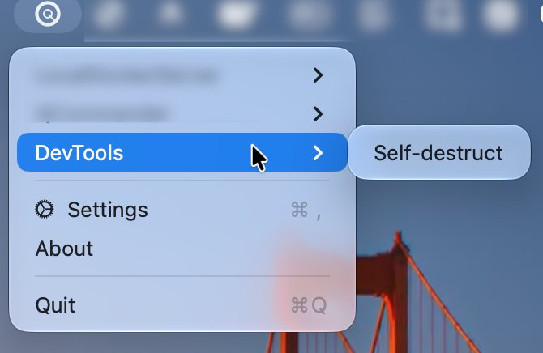
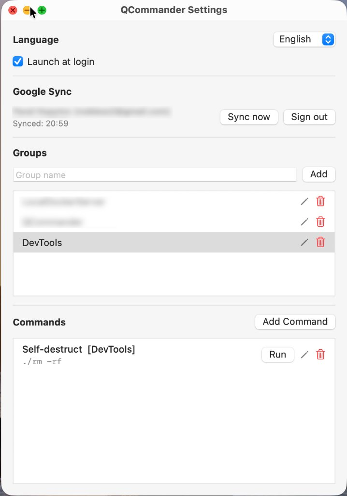

<h1 align="center">
  &nbsp;&nbsp;QCommander
</h1>

  <a href="#english">English</a> | <a href="#russian">Русский</a>

  
  &nbsp;&nbsp;&nbsp;&nbsp;
  

---

**QCommander** is a lightweight macOS menu bar utility for quickly running custom shell commands, organizing them into groups, and syncing your configuration across devices.

### Key Features

- **Quick Menu Bar Access** — run any saved command in one click directly from the macOS menu bar.
- **Command Groups** — organize your commands into categories for clean navigation.
- **Google Drive Sync** — automatically back up and sync your commands and groups across your Macs.

### Installation

1. Download the latest `QCommander.zip` from [Releases](https://github.com/nobless2/QCommander/releases).
2. Unzip the archive and move `QCommander.app` to **Applications**.
3. Launch the app — its icon will appear in the menu bar.

---

**QCommander** — лёгкая утилита для строки меню macOS (Menu Bar), позволяющая быстро запускать пользовательские команды, организовывать их по группам и синхронизировать конфигурацию между устройствами.

### Основные возможности

- **Быстрый запуск из строки меню** — доступ ко всем сохранённым командам в один клик прямо из системного трея macOS.
- **Группировка команд** — распределяйте команды по категориям для удобной навигации.
- **Синхронизация через Google Drive** — автоматическое резервное копирование и синхронизация списка команд и групп между вашими Mac.

### Установка

1. Скачайте последний релиз `QCommander.zip` со страницы [Releases](https://github.com/nobless2/QCommander/releases).
2. Распакуйте архив и переместите `QCommander.app` в папку **Программы** (`Applications`).
3. Запустите приложение — иконка появится в строке меню.
